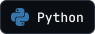
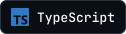
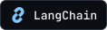
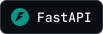
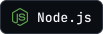
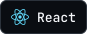

<a href="https://www.kardoso.dev">
  <picture>
    <source media="(max-width: 600px)" srcset="./assets/trace-narrow.svg">
    
  </picture>
</a>

## Stack

 

 

 

 

**IA:** agentes, RAG, GraphRAG, hybrid search, reranking, tool calling, guardrails, human-in-the-loop, LLM-as-a-Judge 
**Confiabilidade:** idempotência, retries, circuit breakers, filas, arquitetura orientada a eventos, tracing

## Repositórios públicos

### Laboratórios

**Laboratório de resiliência do Postgres:** timeout, bulkhead, circuit breaker do zero. 
Repositório: [postgres-resilience-lab](https://github.com/guilhermekardoso/postgres-resilience-lab)

### Código aberto

**Marginalia:** leitor de EPUB e PDF para Android, feito para estudar: destaques, notas e exportação em Markdown. 100% offline. 
Repositório: [marginalia](https://github.com/guilhermekardoso/marginalia)

### Contribuições

**Datarisk MLOps - SDK:** A Python SDK for interacting with the MLOps API, providing tools for training, deploying, and monitoring machine learning models. 
Repositório: [mlops_codex](https://github.com/datarisk-io/mlops_codex)

<b>Trajetória em texto</b>

- **Rottus**, cofundador e AI Product Engineer: abr/2026 até hoje
- **Trinks**, AI Software Engineer, IA para atendimento de barbearias, salões e clínicas: nov/2025 a mar/2026
- **TCE-RO**, AI Full-Stack Sênior, LIDIA, sistema de análise de licitações: mar/2025 a nov/2025
- **IDS Software**, Machine Learning III, GraphRAG e IA aplicados à saúde e educação pública: set/2024 a mar/2025
- **Datarisk**, Engenheiro de Machine Learning, MLOps: jul/2023 a set/2024
- **EEmovel**, Engenheiro de Machine Learning P&D: mar/2022 a jul/2023
- **Ressoar**, Full-Stack, plataforma de ensino com mais de 2 mil usuários: mar/2020 a mar/2022
- **EEmovel**, Analista de Aquisição de Dados, mais de 10 milhões de registros de imóveis: mar/2019 a fev/2020

[kardoso.dev](https://www.kardoso.dev) · [LinkedIn](https://www.linkedin.com/in/guilhermekardoso) · gkardoso@hotmail.com
